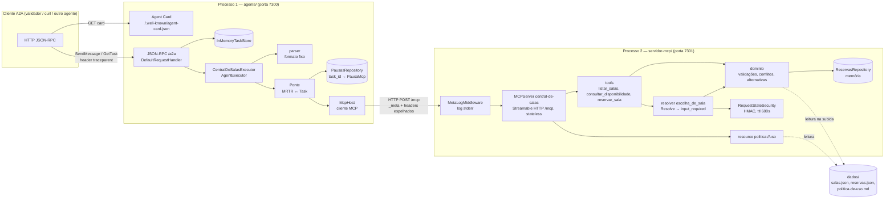
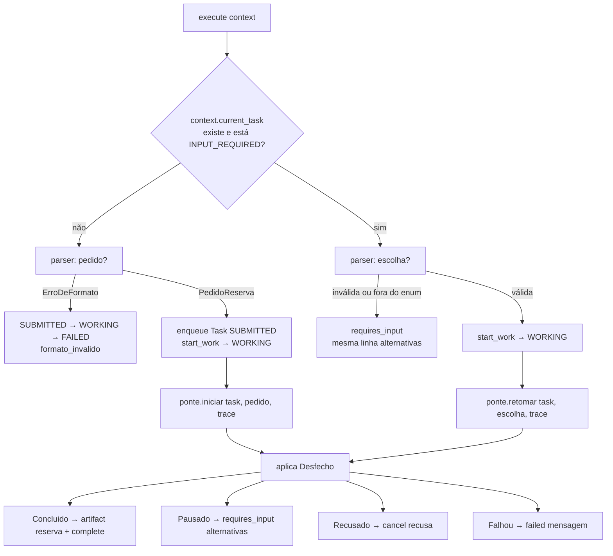
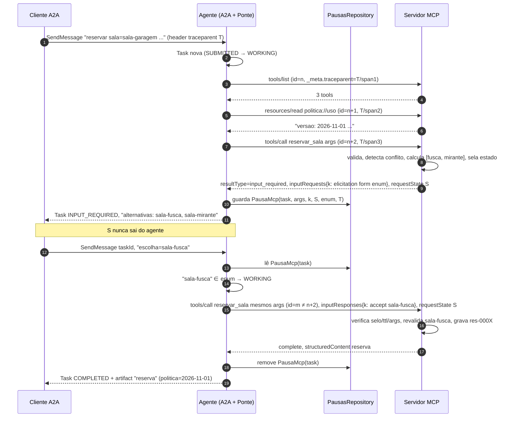
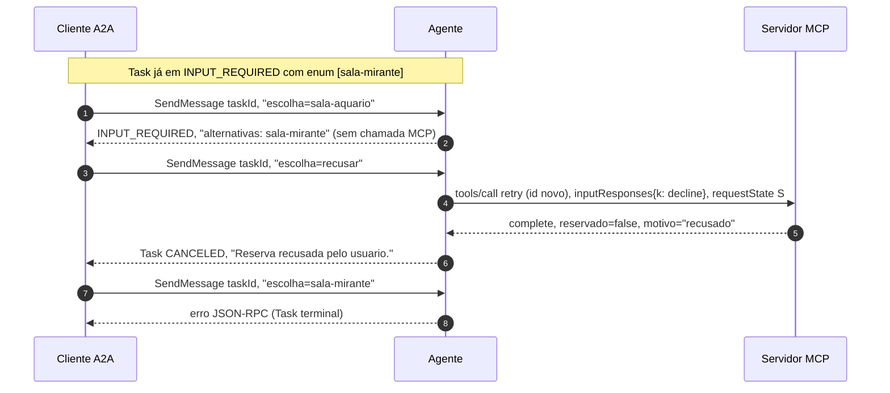
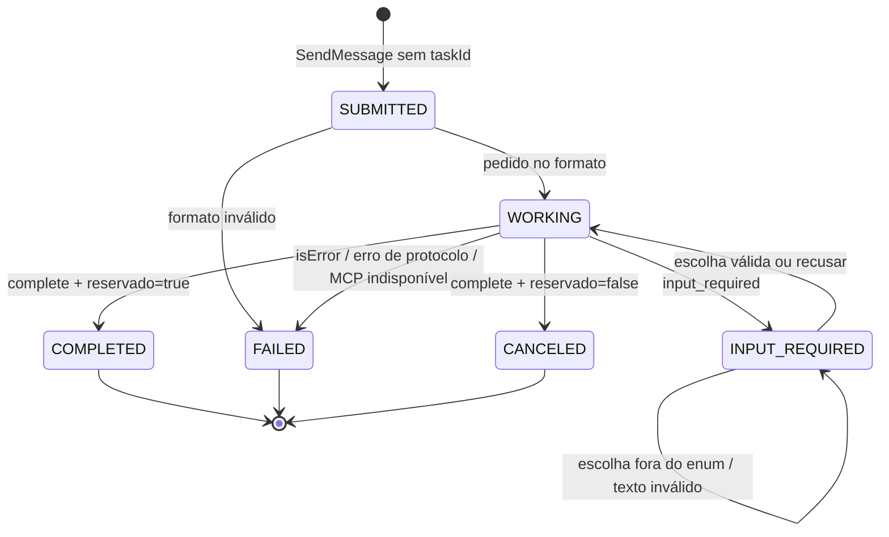

# FDD — Desenho Técnico da Central de Salas

| Campo | Valor |
|---|---|
| Produto | Central de Salas (Agente A2A com MCP) |
| Documento | Functional / Feature Design Document (o **como**) |
| Documentos relacionados | [`PRD.md`](PRD.md) (requisitos RF/RNF), [`ADR.md`](ADR.md) (decisões) |
| Contrato de wire | `exemplos/wire/01..11` |
| Data | 2026-11-04 |

> Convenção: nomes de API dos SDKs seguem a documentação consultada (ver nota de evidências no ADR). Pontos marcados com ✅ **Confirmado** foram verificados no código-fonte/documentação dos SDKs (`mcp` v2.3.0, `a2a-sdk` main) em 2026-11-04.

---

## 1. Visão de componentes



**Fronteira de estado** (o que atravessa cada lado):

| Estado | Dono | Visível para |
|---|---|---|
| Task (id, contextId, status, history, artifacts) | `InMemoryTaskStore` (agente) | Cliente A2A |
| `PausaMcp` (chave, `requestState`, enum, args, trace) | `PausasRepository` (agente) | Ninguém fora do agente |
| `requestState` selado | Cliente MCP (agente) carrega; servidor sela/abre | Opaco para o agente |
| Reservas | `ReservasRepository` (servidor) | Via tools |

---

## 2. Estrutura de diretórios

```
.
├── README.md
├── docs/                         PRD.md, ADR.md, FDD.md
├── dados/  validador/  exemplos/ (intocados)
├── .env.example                  nomes das variáveis, sem valores secretos
├── servidor-mcp/
│   ├── pyproject.toml            mcp==2.3.0, uvicorn==..., pydantic==... (travados)
│   ├── uv.lock
│   └── servidor_mcp/
│       ├── __main__.py           entrypoint: lê config, monta app, sobe uvicorn
│       ├── config.py             env vars + validação (segredo, TTL, portas, DADOS_DIR)
│       ├── modelos.py            Pydantic: SalaOut, ListaDeSalas, ConflitoOut, Disponibilidade, ReservaOut
│       ├── dados.py              carga de salas, reservas iniciais e política (versão)
│       ├── repositorio.py        ReservasRepository (memória, ids res-NNNN)
│       ├── dominio.py            validar_pedido, conflitos, calcular_alternativas, ErroDeNegocio
│       ├── servidor.py           MCPServer: tools, resource, resolver escolha_de_sala, RequestStateSecurity
│       └── middleware.py         MetaLogMiddleware (log stderr + -32602/400 de _meta)
└── agente/
    ├── pyproject.toml            a2a-sdk==1.3.0, mcp==2.3.0, uvicorn==..., starlette/fastapi==... (travados)
    ├── uv.lock
    └── agente/
        ├── __main__.py           entrypoint: monta card, handler, rotas, middleware, uvicorn
        ├── config.py             env vars
        ├── card.py               AgentCard v1.0
        ├── trace.py              leitura do header (call_context), validação e geração de traceparent
        ├── parser.py             PedidoReserva, Escolha, ErroDeFormato
        ├── mensagens.py          textos fixos (alternativas, sucesso, recusa, formato)
        ├── mcp_host.py           McpHost, ClienteCentralDeSalas/SessaoCentralDeSalas (capability form-only), MRTR cru
        ├── pausas.py             PausaMcp + PausasRepository
        ├── ponte.py              Ponte: traduz resultado MCP → transição de Task
        └── executor.py           CentralDeSalasExecutor (AgentExecutor)
```

Arquivos de apoio opcionais na raiz: `scripts/subir-mcp.sh`, `scripts/subir-agente.sh` (carregam `.env` e chamam `uv run`).

---

## 3. Servidor MCP (`servidor-mcp/`)

### 3.1 Inicialização

1. `config.py` lê o ambiente (§7). `REQUEST_STATE_SECRET` ausente, não-hex ou < 32 bytes → `SystemExit` com mensagem em stderr e instrução de geração.
2. `dados.py` carrega `DADOS_DIR/salas.json`, `reservas.json` e `politica-de-uso.md`; a versão é `linha1.split(":", 1)[1].strip()` quando `linha1` começa com `versao:`.
3. `servidor.py` importa `from mcp.server.mcpserver import MCPServer, RequestStateSecurity` e cria `MCPServer("central-de-salas", request_state_security=RequestStateSecurity(keys=[segredo], audience="central-de-salas", ttl=ttl))`; registra tools e resource.
   - ✅ **Confirmado** (`docs/handlers/multi-round-trip.md` v2.3.0, seção *Protecting requestState*): o kwarg é `request_state_security`; o exemplo oficial é `MCPServer("fleet", request_state_security=RequestStateSecurity(keys=[key]))`. `ttl` em **segundos**, default **600**, re-selado a cada rodada (limita o tempo de resposta por rodada). `keys[0]` sela e todas as chaves da lista verificam (rotação). O token fica amarrado à janela de tempo, ao request de origem e à pergunta feita.
   - `serverInfo.version` (`1.0.0` no wire): ✅ **confirmado**, é o kwarg `version: str = ""` do construtor (`src/mcp/server/mcpserver/server.py`). Usar `MCPServer("central-de-salas", version="1.0.0", request_state_security=...)`.
4. `__main__.py` obtém o app com `app = mcp.streamable_http_app(stateless_http=True, json_response=True, streamable_http_path=MCP_PATH)`, envolve com `MetaLogMiddleware(app)` e sobe com `uvicorn.run(..., host=MCP_HOST, port=MCP_PORT)`.
   - ✅ **Confirmado** (`docs/run/asgi.md` v2.3.0): `mcp.streamable_http_app()` devolve uma aplicação Starlette e "takes the same keyword arguments as `mcp.run("streamable-http", ...)`", exceto `port`. O nome do transporte é `"streamable-http"`.
   - O middleware **envolve** o app, sem montá-lo como sub-aplicação, então o `lifespan` do próprio app (que entra em `mcp.session_manager.run()`) continua rodando: o middleware repassa ao app, sem alterar, todo `scope` que não seja `http` (inclusive `lifespan`). Se o app for montado (`Mount`), o host precisa entrar em `mcp.session_manager.run()` no próprio lifespan; caso contrário, o erro é `RuntimeError: Task group is not initialized`.

### 3.2 `MetaLogMiddleware`

O middleware **só registra**, sem validar nem alterar nada. Executa para `POST {MCP_PATH}`:

1. Lê o corpo inteiro (acumulando `http.request` até `more_body=False`) e cria um `receive` substituto que reentrega o mesmo corpo ao app.
2. Faz parse do JSON. Se falhar, só repassa: o SDK responde -32700 com HTTP 400.
3. Extrai `method`, `id`, `params._meta.traceparent` e o header `Mcp-Name`.
4. Envolve `send` para capturar o status HTTP e loga **uma linha** em stderr ao final, inclusive para requests que o SDK rejeitou:
   ```
   2026-11-04T19:02:11.123Z mcp method=tools/call id=4 name=reservar_sala traceparent=00-4bf9…4736-a1b2…-01 status=200
   ```

✅ **Validação de protocolo é nativa do SDK**, confirmada em `src/mcp/shared/inbound.py` e `src/mcp/server/_streamable_http_modern.py` v2.3.0:
- **Roteamento**: o `StreamableHTTPSessionManager` manda à rota moderna (2026-07-28) todo request cujo header `MCP-Protocol-Version` não é uma versão de handshake legada. O validador e o agente sempre enviam `MCP-Protocol-Version: 2026-07-28`. Um request **sem** esse header cai na rota legada (com `initialize`), o que fica fora do contrato e só é mencionado no README.
- **`_meta`**: `classify_inbound_request` rejeita com `INVALID_PARAMS` (-32602) se `params._meta` não for objeto ou não tiver `io.modelcontextprotocol/protocolVersion` e `io.modelcontextprotocol/clientCapabilities` (V04, V05). Não há inferência a partir de request anterior.
- **Headers espelhados**: `MCP-Protocol-Version` diferente do `_meta`, `Mcp-Method` diferente do `method`, `Mcp-Name` diferente do nome e header duplicado resultam em `HEADER_MISMATCH` (-32020).
- **Status HTTP**: a tabela `ERROR_CODE_HTTP_STATUS` vale para erros do classificador **e** dos handlers. Mapeia `PARSE_ERROR`, `INVALID_REQUEST`, `INVALID_PARAMS`, `HEADER_MISMATCH`, `MISSING_REQUIRED_CLIENT_CAPABILITY` e `UNSUPPORTED_PROTOCOL_VERSION` para **400**, e `METHOD_NOT_FOUND` para 404. O -32021 do resolver sai com HTTP 400 sem ajuste (V15, wire 06). `requestState` inválido e URI inexistente (-32602) também saem com 400, o que o validador aceita, porque só confere o `code`.

### 3.3 Modelos (Pydantic) e schemas

Os modelos reproduzem os `outputSchema` de `exemplos/wire/01-tools-list.json`:

| Modelo | Campos |
|---|---|
| `SalaOut` | `id: str`, `nome: str`, `capacidade: int`, `recursos: list[str]` |
| `ListaDeSalas` | `salas: list[SalaOut]` |
| `ConflitoOut` | `id`, `inicio`, `fim`, `responsavel` (str) |
| `Disponibilidade` | `sala: str`, `livre: bool`, `conflitos: list[ConflitoOut]` |
| `ReservaOut` | `reserva: str \| None`, `reservado: bool = True`, `sala`, `inicio`, `fim`, `responsavel`, `politica`, `motivo` (todos `str \| None = None`) |

Cada tool retorna o **modelo Pydantic**, e o SDK gera os dois formatos. ✅ **Confirmado** em `func_metadata.convert_result` (v2.3.0): `structured_content = model_dump(mode="json", by_alias=True)` e o bloco `text` é `pydantic_core.to_json(result, indent=2)`. Assim `json.loads(texto) == structuredContent` vale (V03), no mesmo formato indentado do wire 02. O `outputSchema` também sai do tipo de retorno anotado.

### 3.4 Tools

| Tool | Entrada | Saída de sucesso | Erros de execução |
|---|---|---|---|
| `listar_salas` | `{}` | `ListaDeSalas` | — |
| `consultar_disponibilidade` | `sala, inicio, fim` | `Disponibilidade` (livre/conflitos) | sala, intervalo, janela, duração |
| `reservar_sala` | `sala, inicio, fim, responsavel` | `ReservaOut` (`reservado: true`) ou recusa (`reservado: false, motivo: "recusado"`) | sala, intervalo, janela, duração, sem alternativas |

Descrições (iguais ao wire 01):
- `listar_salas`: "Lista todas as salas com capacidade e recursos."
- `consultar_disponibilidade`: "Diz se uma sala esta livre no intervalo, e quais reservas conflitam."
- `reservar_sala`: "Reserva uma sala. Se o intervalo estiver ocupado, pergunta qual alternativa usar."

Erros de execução: `dominio.ErroDeNegocio` **é subclasse de `ToolError`** (`mcp.server.mcpserver.exceptions`). ✅ **Confirmado** em `tools/base.py` (v2.3.0): só `ToolError`/`ResourceError`, vindos da tool **ou de um resolver**, viram `isError: true` com o texto preservado (`Error executing tool <nome>: <mensagem>`, prefixo aceito pelo validador). **Qualquer outra exceção** é tratada como crash: vira `UnexpectedToolError("Error executing tool <nome>")` **sem a mensagem**, e as verificações V09–V12 e V20 falhariam. `MCPError` (ex.: -32021) passa direto como erro JSON-RPC.

Tool desconhecida: `tool_manager` levanta `ToolError("Unknown tool: <nome>")`, que vira `isError: true`, caminho aceito pela V06.

### 3.5 Validação de domínio (`dominio.validar_pedido`)

Ordem fixa (a primeira falha vence):

| # | Verificação | Mensagem |
|---|---|---|
| 1 | `sala` existe em `salas.json` | `Sala inexistente: <sala>` |
| 2 | `inicio` e `fim` são ISO 8601 **com fuso** (`datetime.fromisoformat`, `tzinfo` presente) | `Intervalo invalido: fim deve ser posterior a inicio` (decisão: data ilegível é tratada como intervalo inválido; não há mensagem própria no enunciado) |
| 3 | `fim > inicio` | `Intervalo invalido: fim deve ser posterior a inicio` |
| 4 | Convertidos para `-03:00`: mesma data local, `inicio.time() >= 08:00`, `fim.time() <= 20:00` (fim às 20:00 é permitido) | `Fora da janela de uso: a politica permite reservas entre 08:00 e 20:00` |
| 5 | `fim - inicio <= 2h` | `Duracao acima do limite: a politica permite no maximo 2 horas` |

Conferência com o validador: V10 (07–08 → janela), V11 (09–12 → janela ok, duração 3h → duração), V12 (10→09 → intervalo).

**Conflito**: reservas `r` da mesma sala com `r.inicio < fim and inicio < r.fim` (intervalos semiabertos; encostar não conflita).

**Alternativas** (`calcular_alternativas(sala, inicio, fim)`):
```
cap = capacidade(sala)
candidatas = [s for s in salas if s.id != sala and s.capacidade >= cap and livre(s.id, inicio, fim)]
ordenar por (s.capacidade, s.id)
retornar ids das 3 primeiras
```

### 3.6 `reservar_sala` e o ciclo MRTR

Desenho com dependência `Resolve` (ADR-005), no padrão de `docs_src/elicitation/tutorial004.py` do SDK:

```python
from typing import Annotated, Literal
from pydantic import BaseModel, Field, create_model
from mcp.server.mcpserver import (MCPServer, RequestStateSecurity, Resolve, Elicit, ElicitationResult,
                                  AcceptedElicitation, DeclinedElicitation, CancelledElicitation)
from mcp.server.mcpserver.exceptions import ToolError

class EscolhaSala(BaseModel):
    sala: str

def modelo_escolha(alternativas: list[str]) -> type[EscolhaSala]:
    # Literal de strings vira "enum" no requestedSchema (docs/handlers/elicitation.md)
    tipo = Literal.__getitem__(tuple(alternativas))
    return create_model("EscolhaSala", __base__=EscolhaSala,
                        sala=(tipo, Field(title="Sala", description="Sala alternativa escolhida")))

async def escolha_de_sala(sala: str, inicio: str, fim: str) -> EscolhaSala | Elicit[EscolhaSala]:
    pedido = dominio.validar_pedido(sala, inicio, fim)        # ErroDeNegocio → ToolError → isError
    if repo.livre(pedido.sala, pedido.inicio, pedido.fim):
        return EscolhaSala(sala=pedido.sala)                  # livre: sem pergunta, sem ida extra
    alternativas = dominio.calcular_alternativas(pedido)
    if not alternativas:
        raise ToolError("Sem alternativas disponiveis no intervalo")
    return Elicit("A sala pedida esta ocupada nesse intervalo. Escolha uma alternativa.",
                  modelo_escolha(alternativas))

@mcp.tool(description="Reserva uma sala. Se o intervalo estiver ocupado, pergunta qual alternativa usar.")
async def reservar_sala(sala: str, inicio: str, fim: str, responsavel: str,
                        escolha: Annotated[ElicitationResult[EscolhaSala], Resolve(escolha_de_sala)]) -> ReservaOut:
    match escolha:
        case AcceptedElicitation(data=d):   return await repo.reservar(d.sala, inicio, fim, responsavel)
        case DeclinedElicitation() | CancelledElicitation():
            return ReservaOut(reserva=None, reservado=False, motivo="recusado")
```

O modelo dinâmico produz o schema plano do wire 03 (`{"sala": {"type":"string","title":"Sala","description":"Sala alternativa escolhida","enum":[...]}}`, `required: ["sala"]`). ✅ **Testado** com Pydantic 2.12: duas ou mais alternativas geram `{"enum": [...], "type": "string", "title": "Sala", "description": "Sala alternativa escolhida"}`, idêntico ao wire 03. **Uma única alternativa gera `{"const": "sala-mirante", "type": "string", ...}`, sem `enum`.** O validador aceita as duas formas, e o agente lê `enum` ou `[const]` (§6.2), o que é obrigatório para V32, V33 e V36, em que só sobra `sala-mirante`.

Comportamento do corpo da tool:

| `escolha` injetada | Resultado |
|---|---|
| `AcceptedElicitation(data=EscolhaSala(sala=<pedida>))`, quando o resolver retornou direto (caminho livre) | grava a reserva na sala pedida e devolve `ReservaOut(reservado=True, …, politica=versao)` |
| `AcceptedElicitation(data=<modelo dinâmico>)`, quando o usuário aceitou uma alternativa `X` | grava a reserva em `X` com `inicio`, `fim` e `responsavel` do request, que o selo garante serem os mesmos da primeira ida |
| `DeclinedElicitation` / `CancelledElicitation` | devolve `ReservaOut(reserva=None, reservado=False, motivo="recusado")`, com os demais campos `null` e `isError` falso |

`repo.reservar` refaz a checagem de conflito antes de gravar (sem `await` entre checar e gravar; concorrência de escrita está fora de escopo). Se `X` deixou de estar livre entre o resolver e a gravação, devolve `ToolError("Sem alternativas disponiveis no intervalo")`.

✅ **Confirmado no código do SDK** (`src/mcp/server/mcpserver/resolve.py` e `src/mcp/server/request_state.py`, v2.3.0):
- **O resolver roda de novo no retry**, com os argumentos do request. A resposta só é consumida se o *digest da pergunta* renderizada for igual ao da pergunta selada. Se as alternativas mudaram entre as idas, o SDK descarta a resposta e **pergunta de novo** (novo `input_required`); o agente trata isso como nova pausa (§6.2).
- **Validação da resposta**: o `content` é validado contra o modelo (`marker.schema.model_validate`). Uma sala fora do `enum` gera `ToolError("Resolver '<chave>' received an accepted elicitation whose content does not match the requested schema")`, que chega como `isError`. Não é preciso validação manual de "escolha ∈ alternativas".
- **Amarração aos argumentos**: o envelope selado amarra `(target, args-digest, principal)`, além de expiração e audience, e falha fechado. Um retry com argumentos adulterados é rejeitado com `-32602 "Invalid or expired requestState"` antes de o resolver rodar, o que cobre a V18 pelo caminho "rejeita". Adulteração e expiração seguem o mesmo caminho (V17).
- **Codec padrão**: `AESGCMRequestStateCodec`, com AES-GCM e chave derivada por HKDF. O estado fica cifrado e autenticado (AEAD). `keys` aceita `bytes` ou `str`.
- **Capability**: o SDK só checa `elicitation.form` quando vai **de fato perguntar** (`_require_capability` no ramo sem resposta). Por isso o caminho livre funciona para qualquer cliente, e o conflito sem capability gera `MCPError(code=MISSING_REQUIRED_CLIENT_CAPABILITY)` (-32021) com `requiredCapabilities` (V15). O HTTP 400 continua garantido pelo middleware (§3.2).
- **Chave do `inputRequests`**: é `f"{fn.__module__}:{fn.__qualname__}"` do resolver (ex.: `servidor_mcp.servidor:escolha_de_sala`). Recebe o sufixo `#n` se o mesmo resolver aparecer mais de uma vez.
- **Ordem com erros de domínio**: as validações rodam no resolver, antes de qualquer pergunta. Por isso sala inexistente, janela, duração e intervalo inválido chegam como `isError` mesmo de clientes sem capability.

**Plano B** (ADR-005), mantido só como contingência: um handler de baixo nível que devolve `InputRequiredResult` à mão, com o estado selado pelo mesmo `RequestStateSecurity`.

### 3.7 Resource `politica://uso`

- `@mcp.resource("politica://uso", mime_type="text/markdown")` devolve o texto integral do arquivo.
- URI desconhecida → `-32602` (V08). ✅ **Confirmado** no código do SDK v2.3.0: o `resource_manager` levanta `ResourceNotFoundError("Unknown resource: <uri>")`, e o `server.py` o converte em `INVALID_PARAMS` (`code = INVALID_PARAMS if isinstance(err, ResourceNotFoundError) else INTERNAL_ERROR`).

### 3.8 Tabela-resumo de respostas

| Request | Condição | Resposta |
|---|---|---|
| qualquer | `_meta` incompleto | HTTP 400, `-32602` |
| qualquer | header espelhado ≠ corpo | HTTP 400, `-32020` (SDK) |
| `tools/call` | tool desconhecida | `-32602` ou `isError` (SDK) |
| `tools/call reservar_sala` | livre e válido | `complete`, `reservado: true` |
| `tools/call reservar_sala` | conflito com alternativas, cliente com `elicitation.form` | `input_required` + 1 `inputRequests` + `requestState` |
| `tools/call reservar_sala` | conflito com alternativas, cliente sem capability | HTTP 400, `-32021`, `data.requiredCapabilities` |
| `tools/call reservar_sala` | conflito sem alternativas | `complete`, `isError: true`, "Sem alternativas…" |
| retry | estado inválido/expirado/args divergentes | `-32602` |
| retry | `accept` válido | `complete`, reserva na sala escolhida |
| retry | `decline`/`cancel` | `complete`, `reservado: false`, `motivo: "recusado"` |
| `resources/read` | `politica://uso` | `contents[0]` markdown |
| `resources/read` | URI desconhecida | `-32602` |

---

## 4. Agente — lado A2A (`agente/`)

### 4.1 Agent Card

`card.py` monta `AgentCard` com os valores do wire 07:

| Campo | Valor |
|---|---|
| `name` / `description` | `Central de Salas` / `Reserva salas de reuniao da Hill Valley Tech.` |
| `provider` | `Hill Valley Tech`, `https://hillvalley.example` |
| `version` | `1.0.0` |
| `supportedInterfaces` | `[{url: AGENTE_PUBLIC_URL + AGENTE_A2A_PATH, protocolBinding: "JSONRPC", protocolVersion: "1.0"}]` |
| `capabilities` | `streaming: false`, `pushNotifications: false`, `extendedAgentCard: false` |
| `defaultInputModes` / `defaultOutputModes` | `["text/plain"]` |
| `skills[0]` | `id: reservar-sala`, nome, descrição, tags `salas, agenda`, modos `text/plain`, exemplo do pedido |

Nada de `requestState`, URLs do MCP ou segredos no card.

### 4.2 Montagem do servidor

```python
task_store = InMemoryTaskStore()
handler = DefaultRequestHandler(agent_executor=CentralDeSalasExecutor(ponte), task_store=task_store, agent_card=card)
app = Starlette(routes=[*create_agent_card_routes(agent_card=card),
                        *create_jsonrpc_routes(request_handler=handler, rpc_url="/a2a")])
uvicorn.run(app, host=AGENTE_HOST, port=AGENTE_PORT)
```

✅ **Confirmado** no código do `a2a-sdk` **v1.3.0** (versão a travar):
- `DefaultRequestHandler` é um alias de `DefaultRequestHandlerV2` (`request_handlers/__init__.py`).
- O dispatcher JSON-RPC atende os métodos `SendMessage` e `GetTask` com esses nomes (`METHOD_TO_MODEL`).
- **`SendMessage` é bloqueante por padrão.** `on_message_send` consome os eventos até a Task chegar a um estado **terminal ou interrompido** (`TERMINAL_TASK_STATES | INTERRUPTED_TASK_STATES`) e responde `{"task": {...}}` (`SendMessageResponse(task=...)`), como nos wires 08 e 10.
- **`GetTask` responde a Task sem envelope** (`MessageToDict(task)`), e não `{"task": ...}` como no wire 09. É divergência do SDK; o validador aceita as duas formas (`resultado.get("task") or resultado`) e ela fica registrada no README.
- `MessageToDict` omite listas vazias e campos padrão (ex.: `artifacts: []` não aparece). O validador usa `.get(..., [])`.
- **Agent Card**: `create_agent_card_routes` serializa com `agent_card_to_dict`, que acrescenta ao card v1.0 campos de compatibilidade v0.3 (`url`, `preferredTransport`, …). Os campos v1.0 (`supportedInterfaces[].protocolBinding/protocolVersion/url`, `skills`) continuam presentes, e a V22 passa. A diferença em relação ao wire 07 fica registrada no README.

**Achados da implementação** (ADR-008):
- `create_jsonrpc_routes(..., context_builder=ContextoV1())` (`agente/contexto.py`): sem o header `A2A-Version`, o SDK assume v0.3 e recusa `SendMessage` com -32009. O builder lê a ausência como `1.0`.
- O `TaskUpdater` da continuação usa `context.current_task.context_id`, porque o `RequestContext` recebe um `context_id` novo quando a mensagem traz só `taskId`.
- `OTEL_INSTRUMENTATION_A2A_SDK_ENABLED=false` é definido no entrypoint antes de importar `a2a`.

### 4.3 Parser (`parser.py`)

| Entrada | Regex (após `strip()`) | Resultado |
|---|---|---|
| Pedido | `^reservar\s+sala=(\S+)\s+inicio=(\S+)\s+fim=(\S+)\s+responsavel=(.+)$` | `PedidoReserva(sala, inicio, fim, responsavel)` |
| Escolha | `^escolha=(\S+)$` | `Escolha(valor)`; `valor == "recusar"` → `recusar=True` |
| Outro | — | `ErroDeFormato` |

Texto de entrada = `context.get_user_input()` (concatenação das partes de texto).

### 4.4 Mensagens fixas (`mensagens.py`)

| Constante | Texto |
|---|---|
| `alternativas(enum)` | `"alternativas: " + ", ".join(enum)` |
| `sucesso(r)` | `Reserva {reserva} confirmada na {sala}.` |
| `recusa()` | `Reserva recusada pelo usuario.` |
| `formato_invalido()` | `Pedido fora do formato: use reservar sala=<id> inicio=<iso8601> fim=<iso8601> responsavel=<nome>` |
| `estado_invalido()` | `Nao foi possivel retomar a reserva: estado expirado ou invalido` |
| `mcp_indisponivel()` | `Servidor de salas indisponivel` |
| falha de tool | texto do bloco `content` do resultado com `isError: true`, **sem alteração** |

### 4.5 Executor (`CentralDeSalasExecutor.execute`)



Notas:
- Task em estado terminal: recusada antes de chamar `execute` (V31). ✅ **Confirmado** na v1.3.0 (`agent_execution/active_task.py`): ao iniciar a execução, se `task.status.state in TERMINAL_TASK_STATES`, o SDK levanta `UnsupportedOperationError("Task <id> is in terminal state: <STATE>")`, que vira erro JSON-RPC. Um `taskId` inexistente gera `TaskNotFoundError`, e um `contextId` diferente do da Task gera `InvalidParamsError`. Na continuação, o SDK preenche `context.current_task` com a Task armazenada.
- As transições usam `TaskUpdater`. ✅ **Confirmado** (`task_updater.py`): `submit`, `start_work`, `requires_input`, `complete`, `cancel`, `failed`, `reject` e `requires_auth`, todos com assinatura `(message: Message | None = None)`; `add_artifact(parts, artifact_id=None, name=None, ...)`; e `new_agent_message(parts, metadata=None) -> Message`, que cria a mensagem com `ROLE_AGENT` sem enfileirá-la. `update_status` levanta `RuntimeError` se a Task já está em estado terminal.
- **Mensagem no histórico.** Toda mensagem do agente é `role: ROLE_AGENT`, com `taskId` e `contextId`, criada por `updater.new_agent_message(...)`. ✅ **Confirmado** em `tasks/task_manager.py` v1.3.0: a mensagem de um status **só vai para o `history` quando chega a atualização seguinte** (`task.history.append(task.status.message)` antes de copiar o novo status) ou a próxima mensagem do usuário (`update_with_message`). Como **nada vem depois de um estado terminal**, a mensagem final de `FAILED`, `COMPLETED` ou `CANCELED` ficaria só em `status.message`, fora do histórico. O enunciado exige que a mensagem da tool fique "visível no histórico" (V35/A10).
  - Regra: para estados **terminais**, o executor publica a **mesma** `Message` duas vezes: `update_status(TASK_STATE_WORKING, message=m)` e em seguida `failed(message=m)` / `complete(message=m)` / `cancel(message=m)`. A segunda atualização move `m` para o `history`, e `status.message` também é `m`, com o mesmo `messageId`, exatamente como no wire 10.
  - Para `INPUT_REQUIRED`, basta um `requires_input(message=m)`. Na continuação, o SDK move `m` para o histórico antes de anexar a mensagem do usuário, o que reproduz a ordem do wire 10 sem duplicar. Durante a pausa, `GetTask` mostra `m` só em `status.message`; o validador lê dali (V28/V29).

### 4.6 Artifact `reserva`

Montado pelo agente a partir do `structuredContent` do MCP + versão da política lida do resource **pelo agente**:

```python
conteudo = {"reserva": sc["reserva"], "sala": sc["sala"], "inicio": sc["inicio"],
            "fim": sc["fim"], "responsavel": sc["responsavel"], "politica": versao_politica}
Part(text=json.dumps(conteudo, ensure_ascii=False))
```

Formato idêntico ao wire 10. O `artifactId` é gerado pelo SDK/agente.

---

## 5. Agente — lado host MCP (`mcp_host.py`)

### 5.1 Cliente

- Um `Client` MCP vivo por processo: `ClienteCentralDeSalas(MCP_URL, mode="2026-07-28", client_info=Implementation(name="agente-central-de-salas", version="1.0.0"), elicitation_callback=_sentinela)`. ✅ Com `mode="2026-07-28"` o `Client` adota a revisão sem handshake nenhum (`session.adopt(_synthesize_discover(mode))`), então o primeiro request que o servidor vê é o `tools/list`.
- **Capability na forma exata `{"elicitation": {"form": {}}}`** (decisão de 2026-11-04). ✅ **Confirmado** em `client/session.py` v2.3.0: ao registrar qualquer `elicitation_callback`, `ClientSession._build_capabilities(version)` declara `ElicitationCapability(form=FormElicitationCapability(), url=UrlElicitationCapability())`, ou seja `{"form": {}, "url": {}}`. Para ficar igual à letra do enunciado e aos wires 01–05:
  - `SessaoCentralDeSalas(ClientSession)` sobrescreve `_build_capabilities(version)`: chama `super()` e troca `elicitation` por `ElicitationCapability(form=FormElicitationCapability())`.
  - `ClienteCentralDeSalas(Client)` sobrescreve `_build_session(exit_stack)` para instanciar `SessaoCentralDeSalas` com os mesmos argumentos que o `Client` passa (`dispatcher`, `read_timeout_seconds`, `client_info`, `elicitation_callback`, …).
  - Os dois métodos são **privados** do SDK. O risco fica mitigado pela versão travada (`mcp==2.3.0`) e por um teste unitário que confere o `_meta` emitido. O README registra a escolha (RF-DOC-04).
- `_sentinela`: só existe para declarar a capability. Se for chamado, levanta `RuntimeError("elicitation deve passar pela Task A2A")` (ADR-007). Ele nunca é chamado porque o agente usa `client.session.call_tool(...)`: ✅ confirmado que **só `Client.call_tool` roda o loop MRTR** (`_drive_input_required`), enquanto `ClientSession.call_tool(..., allow_input_required=True)` devolve o `InputRequiredResult` cru.
- Chamadas, todas ✅ **confirmadas** em `src/mcp/client/session.py` e `mcp_types/_types.py` (v2.3.0):
  - `session.call_tool(name, arguments, *, input_responses=None, request_state=None, meta=None, allow_input_required=True)` devolve `CallToolResult | InputRequiredResult`. Com `allow_input_required=False` (o padrão), um `InputRequiredResult` levanta `RuntimeError`.
  - `session.read_resource(uri, *, meta=None)`.
  - `session.list_tools(params=PaginatedRequestParams(_meta={"traceparent": ...}))`. `list_tools` **não** tem kwarg `meta`, e o `_meta` vai pelo campo `meta` (alias `_meta`) de `RequestParams`.
  - `RequestParamsMeta` é um `TypedDict` aberto (`extra_items=Any`), então `traceparent` passa intacto. O SDK sobrescreve só as chaves reservadas `io.modelcontextprotocol/protocolVersion`, `clientInfo` e `clientCapabilities`.
- Em conexões 2026-07-28, o SDK carimba em todo request o `_meta` obrigatório e os headers espelhados (`Mcp-Protocol-Version`, `Mcp-Method` e `Mcp-Name` nos métodos com nome).
- **Ids**: o `JSONRPCDispatcher` usa `_allocate_id()`, um contador incremental por cliente (`self._next_id += 1`). Com um `Client` vivo por processo, o retry sempre recebe um id novo.
- **OpenTelemetry**: o SDK só injeta `traceparent` sozinho quando há um `TracerProvider` global configurado. O agente **não** configura um, então o `traceparent` enviado é sempre o nosso (`meta=`), sem conflito.
- **Fallback `httpx`** (ADR-007): `McpHttpClient.request(method, params, name=None, traceparent=None)` monta exatamente o corpo/headers do wire 01–05, com `id = next(contador)` global por processo (nunca repetido).

### 5.2 Operações

| Operação | Quando | Request MCP |
|---|---|---|
| `descobrir()` | início de cada Task nova | `tools/list` → exige `reservar_sala` na lista; guarda o `inputSchema` (só para checar presença; não valida domínio) |
| `politica()` | início de cada Task nova | `resources/read politica://uso` → primeira linha `versao: X` → `X` |
| `reservar(args)` | após descoberta | `tools/call reservar_sala` (primeira ida) |
| `retomar(pausa, resposta)` | continuação válida | `tools/call reservar_sala` com os **mesmos** `arguments` de `pausa`, `inputResponses={pausa.chave_input: resposta}`, `requestState=pausa.request_state` |

Ordem garantida no log do servidor para cada Task: `tools/list` → `resources/read` → `tools/call` (→ `tools/call` retry).

### 5.3 Traceparent

- O executor lê o header direto do contexto da chamada: `context.call_context.state["headers"].get("traceparent")`. ✅ **Confirmado** em `server/routes/common.py` v1.3.0: o `ServerCallContextBuilder` grava `state['headers'] = dict(request.headers)`, com nomes em minúsculas, e o `RequestContext` expõe `call_context`. **Não é preciso middleware nem `contextvar`.** O valor só é usado se casar com `^00-[0-9a-f]{32}-[0-9a-f]{16}-[0-9a-f]{2}$`.
- Task nova: `trace_id` da Task = do header (ou `None`). Continuação: header válido → usa o dele; senão → o `trace_id` guardado na `PausaMcp`.
- Cada request MCP: `traceparent = f"00-{trace_id}-{secrets.token_hex(8)}-01"`. Sem `trace_id` → campo omitido.

---

## 6. A ponte (`ponte.py`)

### 6.1 Tipos

```python
@dataclass(frozen=True)
class PausaMcp:
    tool: str                 # "reservar_sala"
    arguments: dict           # args originais, reenviados idênticos
    chave_input: str          # chave única de inputRequests
    request_state: str        # opaco, ecoado byte a byte
    alternativas: tuple[str, ...]  # ordem do enum (ou (const,))
    trace_id: str | None
    versao_politica: str

Desfecho = Concluido(reserva: dict) | Pausado(alternativas) | Recusado() | Falhou(mensagem)
```

### 6.2 Tradução MCP → A2A

| Resultado MCP | Desfecho | Estado da Task | Efeito na `PausasRepository` |
|---|---|---|---|
| `CallToolResult`, `isError: false`, `reservado: true` | `Concluido` | `COMPLETED` + artifact | remove |
| `CallToolResult`, `isError: false`, `reservado: false` | `Recusado` | `CANCELED` | remove |
| `CallToolResult`, `isError: true` | `Falhou(texto do content)` | `FAILED` | remove |
| `InputRequiredResult` (1 entrada `elicitation/create`, form) | `Pausado(enum)` | `INPUT_REQUIRED` | grava/substitui `PausaMcp` |
| `InputRequiredResult` malformado (≠1 entrada, sem enum/const) | `Falhou("Resposta do servidor de salas nao suportada")` | `FAILED` | remove |
| Erro JSON-RPC `-32602` no retry | `Falhou(estado_invalido)` | `FAILED` | remove |
| Erro JSON-RPC na primeira ida / falha HTTP | `Falhou(mensagem do erro ou mcp_indisponivel)` | `FAILED` | remove |

Extração do enum: `input_requests[chave].params.requestedSchema.properties.sala` → `enum` ou `[const]`. Esta é leitura do **contrato da elicitation**, não do `requestState`.

### 6.3 Tradução A2A → MCP (continuação)

| Texto do usuário | Verificação | Ação |
|---|---|---|
| `escolha=recusar` | — | retry com `{"action": "decline"}` |
| `escolha=<id>` com `id ∈ pausa.alternativas` | pertence ao enum recebido | retry com `{"action": "accept", "content": {"sala": "<id>"}}` |
| `escolha=<id>` fora do enum | — | sem chamada MCP; reemite `INPUT_REQUIRED` com `alternativas(pausa.alternativas)` |
| qualquer outro texto | — | idem ao anterior |

### 6.4 Sequência — pedido com conflito, aceite



### 6.5 Sequência — recusa e escolha inválida



### 6.6 Máquina de estados da Task



Estados terminais não aceitam novas mensagens (erro JSON-RPC). Todos os estados usam a grafia `TASK_STATE_*` no wire.

### 6.7 Concorrência entre Tasks

- `PausasRepository` é um `dict` indexado por `task_id`; cada `PausaMcp` é imutável.
- Nenhum campo de estado da ponte é atributo do executor ou do `McpHost` (que é compartilhado e sem estado de Task).
- O cenário V33 (duas Tasks pausadas, retomadas em sequência) usa entradas distintas; o `requestState` de A nunca é lido na retomada de B.

---

## 7. Configuração

### 7.1 Servidor MCP

| Variável | Default | Regra |
|---|---|---|
| `REQUEST_STATE_SECRET` | — (obrigatória) | hex, ≥ 64 caracteres (≥ 32 bytes); senão o processo não sobe |
| `REQUEST_STATE_TTL_SECONDS` | `600` | inteiro em [300, 1800] |
| `MCP_HOST` | `127.0.0.1` | |
| `MCP_PORT` | `7301` | |
| `MCP_PATH` | `/mcp` | |
| `DADOS_DIR` | `<raiz do repo>/dados` | resolvido a partir do arquivo do pacote |

### 7.2 Agente

| Variável | Default |
|---|---|
| `AGENTE_HOST` | `127.0.0.1` |
| `AGENTE_PORT` | `7300` |
| `AGENTE_A2A_PATH` | `/a2a` |
| `AGENTE_PUBLIC_URL` | `http://127.0.0.1:7300` |
| `MCP_URL` | `http://127.0.0.1:7301/mcp` |
| `MCP_TIMEOUT_SECONDS` | `10` |

O agente **não** recebe `REQUEST_STATE_SECRET` (não abre o estado).

### 7.3 Geração do segredo (README)

```bash
export REQUEST_STATE_SECRET="$(python3 -c 'import secrets; print(secrets.token_hex(32))')"
```

Ou um `.env` local (já listado no `.gitignore`) a partir de `.env.example`. O valor nunca é commitado nem impresso em log.

---

## 8. Logging e observabilidade

| Processo | Destino | Conteúdo mínimo |
|---|---|---|
| Servidor MCP | stderr | uma linha por request: `method`, `id`, `name`, `traceparent`, `status` (valores vindos do cliente fora de ASCII visível são gravados como string JSON escapada, para que ninguém forje uma linha); `WARNING` do SDK com o motivo real de rejeição de `requestState` |
| Agente | stderr | por Task: `task_id`, transição de estado, `trace_id`, método/id de cada request MCP emitido; **nunca** o valor do `requestState` (no máximo `len=`) |

Exemplo de trilha no stderr do MCP para uma Task com pausa (trace `4bf9…4736`):

```
... method=tools/list     id=7  name=-               traceparent=00-4bf9…4736-1111…-01 status=200
... method=resources/read id=8  name=politica://uso  traceparent=00-4bf9…4736-2222…-01 status=200
... method=tools/call     id=9  name=reservar_sala   traceparent=00-4bf9…4736-3333…-01 status=200
... method=tools/call     id=10 name=reservar_sala   traceparent=00-4bf9…4736-4444…-01 status=200
```

---

## 9. Plano de implementação (ordem)

Segue a "Ordem de execução sugerida" do enunciado:

1. `servidor-mcp`: projeto `uv`, config, dados, `listar_salas`; inspecionar com MCP Inspector (`_meta`, `resultType`).
2. Domínio + `consultar_disponibilidade` com as quatro mensagens de erro.
3. `reservar_sala` caminho feliz.
4. MRTR: resolver + `input_required`; `RequestStateSecurity` com segredo de env; -32021; rejeições. Middleware de log/`_meta`/status.
5. Rodar V01–V20 (validador com agente ainda ausente falha só a parte A2A).
6. `agente`: `McpHost` como script que descobre, lê a política e completa o MRTR respondendo à mão.
7. Lado A2A: card, `SendMessage`/`GetTask`, executor e máquina de estados.
8. Ponte: `PausasRepository`, pausa, retomada com id novo, recusa, escolha inválida, traceparent.
9. Validador completo; corrigir até 36/36.
10. README (4 seções) e teste a partir de clone limpo.

---

## 10. Plano de verificação

### 10.1 Automática

```bash
# terminal 1
cd servidor-mcp && uv sync --frozen && uv run python -m servidor_mcp
# terminal 2
cd agente && uv sync --frozen && uv run python -m agente
# terminal 3 (processos recém-iniciados)
python3 validador/validar.py --agente http://localhost:7300 --mcp http://localhost:7301; echo "exit=$?"
```

Esperado: `resumo: 36 passaram, 0 falharam, de 36 verificacoes` e `exit=0`.

### 10.2 Manual (Fluxo do avaliador)

| Passo | Comando / ação | Esperado |
|---|---|---|
| A3 | `curl -s localhost:7300/.well-known/agent-card.json` | `supportedInterfaces[0]` JSONRPC, `1.0`, skill `reservar-sala` |
| A5 | `grep <trace-id do validador>` no stderr do MCP | `tools/list` antes do 1º `tools/call`; mesmo trace-id |
| A6 | stderr do MCP | par de `tools/call reservar_sala` da mesma Task com ids distintos |
| A7 | `curl -s -X POST localhost:7300/a2a -H 'Content-Type: application/json' -d "$(jq -c .request.body exemplos/wire/08-a2a-send-message.json)"` (após restart) | `INPUT_REQUIRED`, `alternativas: sala-fusca, sala-mirante` |
| A8 | `SendMessage` com `taskId` e `escolha=sala-mirante`, depois `GetTask` | `COMPLETED`, artifact `reserva` com `sala-mirante` e `politica` |
| A9 | repetir A7 e responder `escolha=recusar` | `CANCELED` |
| A10 | pedido com `sala=sala-inexistente` | `FAILED`, `Sala inexistente: sala-inexistente` no histórico |
| A11 | `tools/call` do wire 03 direto no MCP, trocar 1 caractere do `requestState`, reenviar como retry | `-32602` |
| A12 | mesmo retry com estado íntegro, **reiniciando o MCP** (mesmo segredo) antes | `complete`, reserva criada |
| A13 | wire 03 com `clientCapabilities: {}` | HTTP 400, `-32021`, `data.requiredCapabilities` |
| — | `git diff --stat <commit inicial> -- dados validador exemplos` | vazio |
| — | `grep -ri "anthropic\|openai\|langchain" */pyproject.toml` | vazio |

### 10.3 Testes unitários (opcionais, recomendados)

- `dominio`: tabela de casos para validações (bordas 08:00/20:00, exatamente 2h, fim = início), conflito semiaberto, ordenação de alternativas e limite de 3.
- `parser`: formatos válidos/inválidos, `recusar`.
- `ponte`: tradução de cada tipo de resultado MCP para `Desfecho`, usando dublês do `McpHost`.
